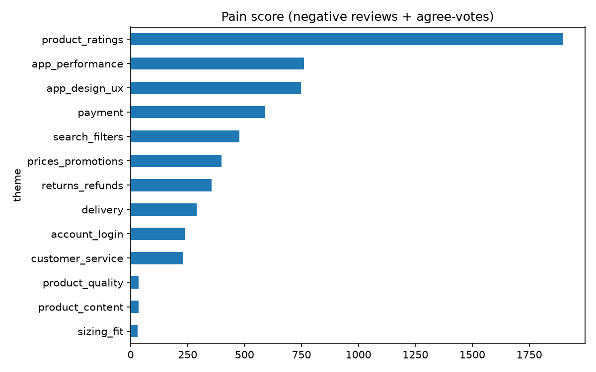
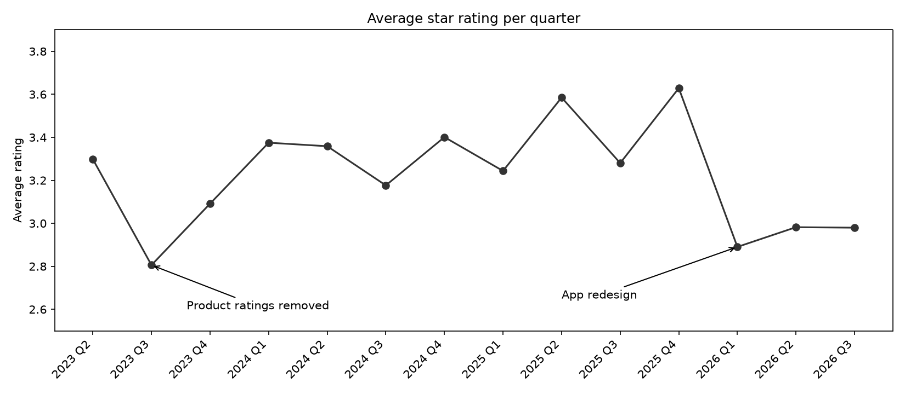

# Zalando App Review Analysis

I analysed 3,000 German Play Store reviews of the Zalando app to find out what frustrates users most, then designed a checkout concept based on the results.

*Personal portfolio project, not affiliated with Zalando.*



## Objective

Find the biggest problems in the Zalando app and decide which one to fix first.

## Goal

- Group the reviews into clear themes (bugs, design, payment, delivery and so on)
- See which problems hurt most and how they changed over time
- Check where shoppers drop off in an online shop funnel
- Pick one feature, write a PRD and build a prototype

## Results


- About **390 negative reviews** are about the app itself (bugs and design), more than any other topic.
- Almost **half of the "bug" complaints were really about the redesign**, not about the app crashing.
- Removed product ratings got the **strongest reaction** of all themes, and the two biggest rating drops (2023 and 2026) happened right after product changes.
- In the funnel data, **about 55% of people who start checkout don't finish**, on every device.
- Top priority after RICE scoring: **a more reliable checkout** (clear error messages, items reserved for 10 minutes, other payment options when a card fails).

## How it's done

1. Collected 3,000 reviews with `google-play-scraper` (user names removed)
2. Tagged each review by theme, sentiment and feature request using Claude ([prompt](docs/tagging_prompt.txt), [rules](docs/tagging_decisions.md))
3. Analysed the tagged data in Python
4. Ran funnel and retention queries in BigQuery on Google's public GA4 sample data
5. Prioritised ideas with RICE and wrote a [PRD](docs/PRD.md)
6. Built a clickable prototype (made with AI help, based on my PRD)

## Try it

**Prototype:** download the repo and open `docs/checkout-prototype/index.html` in your browser. There's also a 60-second demo video in `docs/`.

**Run the analysis with my data:**

```bash
git clone https://github.com/ramya-rajendra/zalando-app-review-analysis.git
cd zalando-app-review-analysis
conda env create -f environment.yml
conda activate productproj
```

Then open the notebooks in VS Code or Jupyter:

- `02_analysis.ipynb` – review analysis and charts (uses the tagged files in `data/`)
- `03_funnel_retention.ipynb` – funnel and retention charts (uses the BigQuery results in `data/`)

**Start from scratch (optional):**

1. `01_collect_reviews.ipynb` collects the newest reviews. This replaces the files in `data/`, so your results will differ from mine.
2. Tag the new files with the prompt in `docs/tagging_prompt.txt`.
3. Run the queries in `sql/` in the free BigQuery sandbox and save the results as CSV in `data/`.

## Folders

```
data/        reviews, tagged files, query results
notebooks/   collection, analysis, funnel
sql/         BigQuery queries
docs/        charts, PRD, tagging rules, prototype
```

## Tools

Python (pandas, matplotlib, statsmodels) · BigQuery SQL · Claude · VS Code · HTML/CSS/JS

---

Ramya Rajendra · [LinkedIn](https://www.linkedin.com/in/ramyarajendra)
